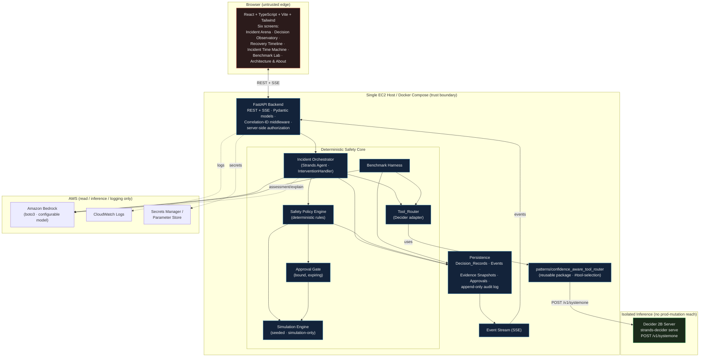
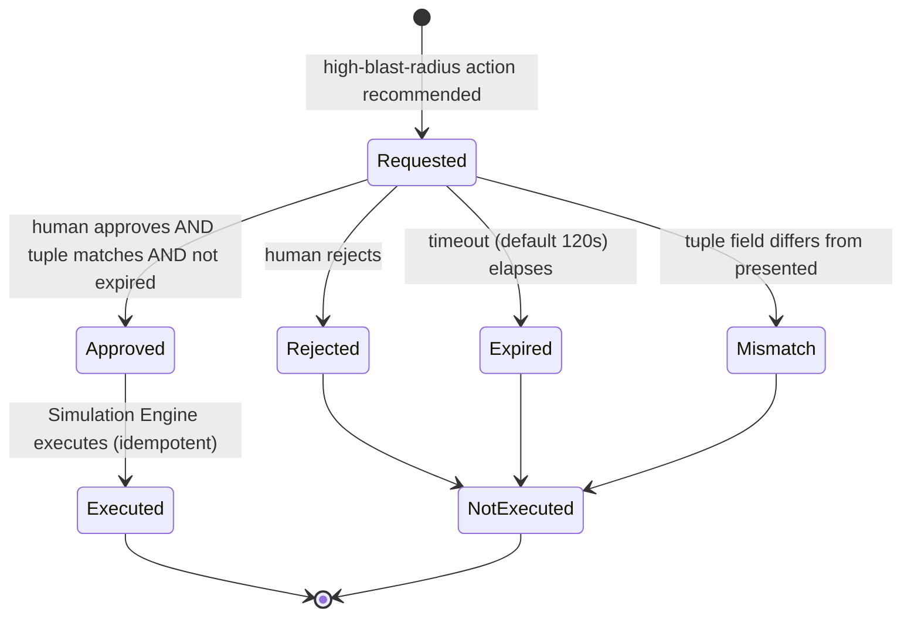
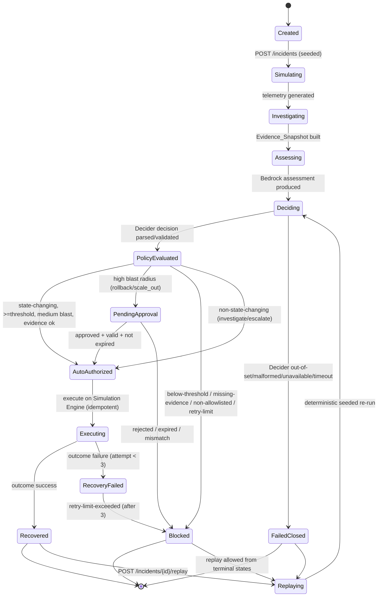
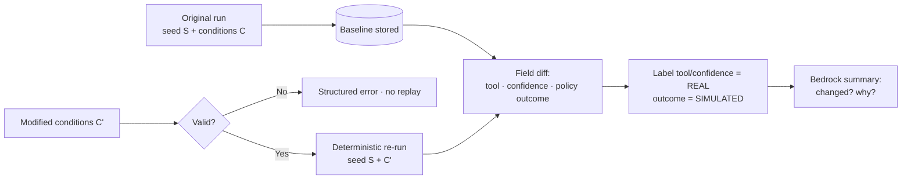
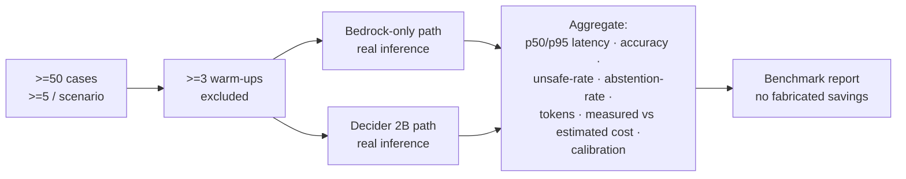
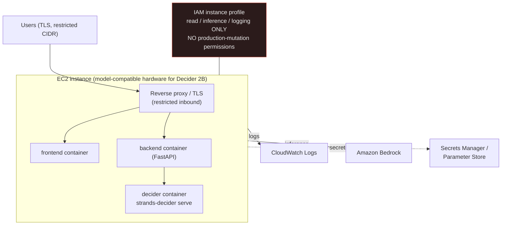

# Design Document

## Overview

AegisPulse AI — *Detect. Decide. Defend.* — is an interactive cloud incident-response arena built for the October 2026 AWS Strands Decider 2B Agent Experience Hackathon. This design translates the finalized requirements into an implementation-ready architecture.

### Core Architectural Principle

The entire system is organized around a strict separation of authority that is the product's thesis and its safety guarantee:

> **The Decider SELECTS. The deterministic Safety Policy Engine AUTHORIZES. Bedrock EXPLAINS. Nothing overrides the one before it.**

- The **Strands Decider 2B** model performs calibrated, confidence-aware tool selection — it is the only component that *chooses* the candidate recovery tool (Req 3.4).
- A **separate deterministic Safety Policy Engine** independently authorizes or blocks that candidate based on allowlisting, evidence sufficiency, a confidence threshold, blast-radius classification, and approval rules. Neither the Decider nor Bedrock can override its outcome (Req 6.2, 5.6).
- **Amazon Bedrock** interprets evidence and produces human-readable explanations and summaries. It never selects a tool and never alters a policy decision (Req 3.5, 5.5, 5.6).
- All remediation is **simulation-only**; no component holds any permission capable of mutating a production AWS resource (Req 1.4, 1.8, 12.1).

### Design Goals (mapped to judging criteria and demo constraint)

| Goal | Design response | Criterion |
|------|-----------------|-----------|
| Make the arena feel like live mission control | Six purpose-built dark-themed screens, real-time SSE event stream, Incident Time Machine (Req 9, 7) | Creativity / cool factor (30%) |
| Prove the Decider materially drives the workflow | Decider output is the sole source of the candidate action; Decision Observatory visualizes per-option scores + calibrated confidence; Benchmark Lab quantifies Decider-vs-Bedrock-only (Req 3, 8, 16.2) | Effective Decider 2B use (30%) |
| Explain decisions clearly | Bedrock-generated assessments, hypotheses, and original-vs-replay summaries; explicit labeling of REAL inference vs SIMULATED outcome vs illustrative sample (Req 5, 7.3, 9.7) | Communication (25%) |
| Original framing | Incident-commander arena with a confidence-gated deterministic policy, distinct from a generic Bedrock-only agent (Req 16.4) | Originality (15%) |
| Under-3-minute demo | MVP vertical slice (one scenario, real Decider + real Bedrock + approval) is the critical path; event stream and pre-seeded scenarios keep the live path fast (Req 16.5, 17.1) | Demo constraint |

### Scope Boundaries

- In scope: deterministic simulation, real Decider 2B inference, real Bedrock reasoning, deterministic policy + approval, counterfactual replay, benchmark harness, six-screen frontend, FastAPI backend, lightweight persistence, Docker/AWS deployment config, reusable tool-router package.
- Out of scope / explicitly forbidden: any create/update/delete against real cloud resources, arbitrary shell execution, unrestricted AWS operations, committed secrets (Req 12.1–12.3, 12.12).

---

## Architecture

AegisPulse is a container-composed system with a clear trust boundary separating the untrusted/external edge (browser, Bedrock, retrieved text) from the deterministic safety core (policy engine, approval gate, simulation engine) and the isolated inference service (local Decider 2B server).



**Trust boundaries**

- The browser and all Bedrock/evidence text are **untrusted** (Req 5.8, 12.10). They enter the system only through the FastAPI edge, which validates every input (Req 10.7, 12.5) and performs server-side authorization on every state-changing request (Req 10.6, 12.4).
- The **Decider 2B server** and the **Simulation Engine** are isolated from any production AWS mutation. The Decider server performs inference only; the Simulation Engine acts only on in-memory simulated infrastructure and holds no AWS mutation client (Req 1.4, 1.8, 6.18).
- The only outbound AWS calls are Bedrock inference, CloudWatch logging, and secrets retrieval — all read/inference/logging, none mutating production resources (Req 14.3).

### Technology Choices

| Layer | Choice | Rationale |
|-------|--------|-----------|
| Frontend | React + TypeScript + Vite + Tailwind | Fast dev loop, strong typing, dark mission-control theming (Req 9.2) |
| Backend | Python 3.11+ + FastAPI + Pydantic | Async REST + SSE, typed models, native fit with Strands/boto3 (Req 10.1, 10.3) |
| Agent | Strands Agents SDK | Required orchestration + InterventionHandler mechanism (Req 2.1, 2.4) |
| Decider | `strands-decider` package + `POST /v1/systemone` | Real Decider 2B inference contract (Req 3.2) |
| Reasoning | Amazon Bedrock via boto3 | Required reasoning provider, default credential chain (Req 5.1, 5.2) |
| Persistence | SQLite via SQLModel (demo-scale) | Zero-ops, file-backed, single-host; adequate for a demo while supporting immutability and append-only audit (see Persistence section) |
| Packaging | Docker + Docker Compose | Required packaging; one compose stack per host (Req 14.1) |

---

## Components and Interfaces

This section enumerates each component, its responsibility, and the interface it exposes to the rest of the system. Detailed signatures for the Strands/Decider and Bedrock integrations appear in their dedicated sections below; the API surface appears in API Contracts.

| Component | Responsibility | Key interface (illustrative) | Requirements |
|-----------|----------------|------------------------------|--------------|
| **Frontend (React/TS/Vite/Tailwind)** | Six mission-control screens; renders events, decisions, approvals; labels real vs sample | Consumes REST + SSE; no direct access to core | 9.1–9.9 |
| **FastAPI Backend** | REST + SSE edge; Pydantic validation; Correlation-ID middleware; server-side authorization | 12 endpoints (see API Contracts) | 10.1–10.7, 12.4 |
| **Incident Orchestrator (Strands Agent)** | Drives the workflow; gathers evidence; registers InterventionHandler; emits timeline events | `investigate(incident) -> EvidenceSnapshot`; `decide(incident) -> DecisionRecord` | 2.1–2.7 |
| **Tool_Router (Decider adapter)** | Builds typed `choice` question; calls `POST /v1/systemone`; parses/validates response | `ConfidenceAwareToolRouter.decide(state, decision) -> DeciderDecision` | 3.1–3.10 |
| **Reusable package** `patterns/confidence_aware_tool_router/` | Independently importable `#tool-selection` pattern | `ToolChoiceDecision`, `DeciderDecision`, `ConfidenceAwareToolRouter`, `build_intervention_handler` | 4.1–4.6 |
| **Decider 2B Server** | Real Decider inference via `strands-decider serve` | HTTP `POST /v1/systemone {state, questions}` | 3.2 |
| **Bedrock Reasoner (boto3)** | Evidence interpretation, hypotheses, explanations, summaries; never selects/authorizes | `assess(evidence) -> Assessment`; `summarize_comparison(...) -> str` | 5.1–5.9, 7.7 |
| **Safety Policy Engine** | Deterministic authorization; allowlist, evidence, threshold, blast-radius, idempotency, retries, audit | `authorize(candidate, confidence, evidence, blast_radius, approval_state, attempts, decider_health) -> PolicyOutcome` | 6.1–6.19, 16.6, 16.7 |
| **Approval Gate** | Holds bound, expiring approvals; exact-match validation | `request(tuple, expiry) -> Approval`; `resolve(tuple, decision) -> ApprovalStatus` | 6.9–6.13, 12.8 |
| **Simulation Engine** | Seeded telemetry generation; simulation-only remediation; recovery outcomes | `generate(scenario, seed) -> Telemetry`; `execute(tool, params) -> RecoveryOutcome` | 1.1–1.8, 6.18 |
| **Persistence** | Immutable Decision_Records, events, snapshots, approvals, append-only audit | `save_decision(...)`, `append_event(...)`, `load_incident(id)` | 11.1–11.4, 12.9 |
| **Benchmark Harness** | Real Bedrock-only vs Decider 2B comparison; metrics; no fabrication | `run(cases, warmups) -> BenchmarkRun` | 8.1–8.9 |
| **Event Stream** | Ordered event fan-out to SSE subscribers | subscribe/replay by `Last-Event-ID` | 10.5, 11.3 |

The interface boundaries enforce the core principle: the Orchestrator obtains a candidate only from the Tool_Router (Decider), passes it to the Safety Policy Engine for authorization, and uses the Bedrock Reasoner only for explanation. No interface allows Bedrock output to reach the Simulation Engine except through Decider selection + policy authorization + (where required) the Approval Gate (Req 12.10).

---

## Decision Lifecycle

The end-to-end user journey is a 14-step pipeline. Fail-closed branches are shown explicitly: any Decider failure (out-of-set, missing/malformed, unavailable/timeout) causes the policy engine to block all automatic state-changing actions while still permitting read-only investigation and escalation (Req 3.8–3.10, 6.14).

```mermaid
sequenceDiagram
    autonumber
    actor U as User
    participant FE as Frontend
    participant API as FastAPI
    participant ORCH as Orchestrator (Strands)
    participant SIM as Simulation Engine
    participant BR as Bedrock Reasoner
    participant TR as Tool_Router
    participant DEC as Decider 2B
    participant POL as Safety Policy
    participant GATE as Approval Gate
    participant ST as Persistence/Events

    U->>FE: 1. Select scenario (one of five)
    FE->>API: POST /incidents {scenario, seed}
    API->>SIM: 2. Simulate telemetry (seeded, deterministic)
    SIM-->>ST: emit telemetry_generated
    API->>ORCH: POST /incidents/{id}/investigate
    ORCH->>SIM: 3. Gather evidence (each telemetry tool once)
    ORCH-->>ST: tool_invoked (xN, ISO-8601 ms + correlation id)
    ORCH->>ORCH: 4. Build Evidence_Snapshot (immutable)
    ORCH-->>ST: evidence_snapshot_created
    ORCH->>BR: 5. Interpret evidence -> assessment
    BR-->>ORCH: assessment (untrusted, validated)
    ORCH-->>ST: bedrock_assessment
    ORCH->>TR: POST /incidents/{id}/decide
    TR->>DEC: 6. POST /v1/systemone {state, questions:[choice, options=5 tools]}
    alt Decider healthy & in-set & well-formed (<=10s)
        DEC-->>TR: 7. {answers:[selected, confidence, per-option scores], model, usage, latency_ms}
        TR->>TR: parse + validate (tool in-set, confidence in [0,1])
        TR-->>ST: decider_decision
        TR->>POL: 8. authorize(candidate, confidence, evidence, blast-radius)
        alt non-state-changing (investigate/escalate)
            POL-->>ORCH: AutoAuthorized (no execution needed)
        else state-changing, confidence < threshold
            POL-->>ORCH: Blocked (below threshold)
        else high-blast-radius (rollback / scale_out)
            POL->>GATE: 9. require approval (bound tuple, expiry)
            GATE-->>FE: approval_requested
            U->>FE: approve / reject
            FE->>API: POST /incidents/{id}/approve
            API->>GATE: validate exact-match + not expired
            alt approved & valid
                GATE-->>POL: authorized
                POL->>SIM: 10-11. execute (idempotent)
            else rejected / expired / mismatch
                GATE-->>ST: approval_rejected|expired
                Note over SIM: not executed
            end
        else medium/low blast-radius, confidence >= threshold
            POL->>SIM: 10-11. execute (idempotent)
        end
        SIM-->>POL: 12. recovery outcome (MTTR, impact, success/failure)
        POL-->>ST: 13. persist Decision_Record (immutable)
        POL-->>ST: action_executed + recovery_measured
    else Decider out-of-set / malformed / unavailable / timeout(>10s)
        TR-->>ST: structured validation/unavailable error (+ correlation id)
        TR->>POL: fail-closed signal
        POL-->>ORCH: Block all automatic state-changing; permit investigate/escalate
        POL-->>ST: policy_evaluated (FailedClosed)
    end
    ST-->>FE: 14. stream events (SSE) throughout
```

---

## Strands / Decider Integration

### Tool_Router over the real Decider contract

The Tool_Router is the only component that talks to the Decider. It wraps the `strands-decider` package and the `POST /v1/systemone` HTTP contract (Req 3.2).

**Request construction (typed `choice` question, fixed option set)** — Req 3.1, 3.6:

The verified `POST /v1/systemone` contract carries `questions` as a **keyed object** (a map of question-id → question), not an array. Each question object has a `type` (one of `noun|choice|score`), an `instructions` field (the prompt text), and for a `choice` question an optional `criteria` map of option-name → option-description. `state` is a free-form text (or serialized incident-state) string.

```jsonc
// POST /v1/systemone
{
  "state": "incident inc_01J... | scenario=Bad_Deployment | evidence=ev_01J... | telemetry_summary: service health, request metrics, error metrics | refs: ev_01J...#svc_health, ev_01J...#error_rate",
  "questions": {
    "recovery_tool": {
      "type": "choice",
      "instructions": "Select the single best recovery tool for this incident.",
      "criteria": {
        "rollback_deployment": "Roll back the most recent deployment",
        "scale_out_service": "Add capacity to the saturated service",
        "restart_unhealthy_tasks": "Restart only the unhealthy tasks",
        "investigate_further": "Gather more evidence before acting",
        "escalate_to_human": "Hand off to a human operator"
      }
    }
  }
}
```

The fixed option set is a module-level constant whose keys are reused as the `criteria` map keys for construction and as the acceptance check for validation, guaranteeing the request and the validation reference the same five tools (Req 3.1).

The `strands-decider ask` CLI exposes a leaner `--choice "name=opt1,opt2,..."` form (option names only), but the HTTP serve API accepts the richer `criteria` map of name → description. The description-bearing form yields materially better selections (a documented hands-on example: with `criteria` descriptions the model selected the correct option at 0.93 confidence, versus an ambiguous pick when only names were supplied). The design therefore uses the serve API with a `criteria` description for each of the five tools.

**Response parsing and validation** — Req 3.3, 3.8, 3.9:

The response carries `answers` as a **keyed object** (a map keyed by the same question ids sent in the request). A `choice` answer uses the field names `choice` (the selected option), `probabilities` (per-option probability map), and `confidence`. There is no top-level answer array and no `selected`/`scores` fields. The `model`, `usage`, and `latency_ms` fields are top-level.

```jsonc
// Decider response shape (verified)
{
  "model": "strands-decider-2B-hobson-v19",
  "answers": {
    "recovery_tool": {
      "type": "choice",
      "choice": "rollback_deployment",
      "probabilities": {
        "rollback_deployment": 0.9251,
        "scale_out_service": 0.0228,
        "restart_unhealthy_tasks": 0.0521,
        "investigate_further": 0.0,
        "escalate_to_human": 0.0
      },
      "confidence": 0.8877
    }
  },
  "usage": { "input_tokens": 161, "output_tokens": 2 },
  "latency_ms": 189.03
}
```

Parsing reads `answers["recovery_tool"].choice` (the selected tool), `answers["recovery_tool"].probabilities` (per-option map), `answers["recovery_tool"].confidence`, and the top-level `model`, `usage`, and `latency_ms`. These are normalized into the internal `DeciderDecision` dataclass by mapping: `selected ← answers[qid].choice`, `scores ← answers[qid].probabilities`, `confidence ← answers[qid].confidence`, `model ← model`, `latency_ms ← latency_ms`, plus the Evidence_Snapshot id carried from the request context. The resulting `DeciderDecision` has: selected tool (must be in-set), calibrated confidence bounded to `[0.0, 1.0]`, per-option scores (from `probabilities`), inference latency (ms), model identifier, and the Evidence_Snapshot id (Req 3.3). Validation rules:

- **Out-of-set tool** → reject (the `choice` value is not one of the five fixed options), record a structured validation error that includes the returned out-of-set value and the Correlation_ID; signal fail-closed (Req 3.8).
- **Missing/invalid required field** (absent `answers[qid].choice`, `confidence` outside `[0,1]`, absent top-level `model`) → structured validation error; fail-closed (Req 3.9).
- **Unavailable or no response within a 10s timeout** → treat as unavailable, return a structured error; fail-closed (Req 3.10).

"Fail-closed" means the Safety Policy blocks all automatic state-changing actions while permitting `investigate_further`, additional evidence collection, and `escalate_to_human` (Req 6.14).

**Model identifier** — two reference model ids are valid and the model id is configurable (Req 5.1): `StrandsAgents/strands-decider-2B-qwen3.5-v1-2610` (reference v1) and `StrandsAgents/strands-decider-2B-hobson-v19` (used in the hands-on measurements in Design Validation Findings). Weights are fetched from Hugging Face on first call, mirrored under the `amazon/` org, licensed Apache-2.0.

### InterventionHandler mapping

The orchestrator registers a `RecoveryInterventionHandler` via `Agent(interventions=[...])`. Its `before_tool_call` composes the Decider selection with the deterministic policy outcome and returns exactly one typed action:

| Decider + Policy result | InterventionHandler action | Meaning |
|-------------------------|----------------------------|---------|
| State-changing, authorized, no approval needed, confidence ≥ threshold | **Proceed** | Execute against Simulation Engine |
| High-blast-radius (rollback / scale_out), any confidence | **Confirm** | Stop and ask a human (Approval Gate) |
| Blocked (below threshold, missing evidence, non-allowlisted, retry limit) | **Deny** | Do not execute; record denied event |
| Fail-closed (Decider out-of-set/malformed/unavailable/timeout) for a state-changing tool | **Deny** | Block automatic state change; investigate/escalate still allowed |
| Needs more evidence or clarification mid-run | **Guide** | Hand the turn back with feedback (e.g., collect more evidence) |

- **Confirm** → agent enters and preserves a pending-approval state until a human decision is recorded (Req 2.5).
- **Deny** → the proposed tool call is not executed and a denied-action timeline event with the Correlation_ID is recorded (Req 2.6).
- Tool errors during evidence gathering are recorded as timeline events (with Correlation_ID), evidence is retained, and the workflow continues without executing an unverified action (Req 2.7).

### Reusable package `patterns/confidence_aware_tool_router/`

Packaged as an independently importable Python package implementing the `#tool-selection` decision pattern using the real Decider 2B model and the documented Strands InterventionHandler mechanism (Req 4.1, 4.2).

Public API (illustrative signatures — not to be scaffolded here):

```python
# patterns/confidence_aware_tool_router/__init__.py
@dataclass(frozen=True)
class ToolChoiceDecision:
    """Typed decision definition for a one-of-N recovery tool choice."""
    question_id: str
    options: tuple[str, ...]          # the fixed option set
    prompt: str

@dataclass(frozen=True)
class DeciderDecision:
    # Normalized representation. Fields map FROM the real serve response:
    #   selected   <- answers[qid].choice
    #   scores      <- answers[qid].probabilities
    #   confidence  <- answers[qid].confidence
    #   model       <- model (top-level)
    #   latency_ms  <- latency_ms (top-level)
    selected: str
    confidence: float                 # bounded [0,1]
    scores: dict[str, float]          # from response `probabilities`
    model: str
    latency_ms: int
    evidence_snapshot_id: str

class ConfidenceAwareToolRouter:
    def __init__(self, endpoint: str, timeout_s: float = 10.0) -> None: ...
    def decide(self, state: Mapping, decision: ToolChoiceDecision) -> DeciderDecision: ...
    # raises OutOfSetError / MalformedResponseError / DeciderUnavailableError

def build_intervention_handler(router, policy) -> "InterventionHandler": ...
```

Package contents (Req 4.3–4.6): pattern implementation, typed decision definition, an example integration, README (referencing `#strands-decider-2b` and `#tool-selection`), unit tests verifying the pattern in isolation, usage docs, limitations docs, and safety guidance. AegisPulse consumes the package only through this public API; the package depends on no AegisPulse application code, keeping the coupling one-directional (Req 4.4).

---

## Bedrock Integration

- **Client**: a boto3 Bedrock Runtime client resolving credentials through the AWS default credential resolution chain (Req 5.2). The Bedrock model id is configurable (Req 5.1).
- **Region/availability pre-check**: before the first invocation, the reasoner verifies the configured model is available in the configured region (e.g., a `list_foundation_models`/availability check); if unavailable it records a structured error and does not invoke (Req 5.7).
- **Uses** (Req 5.3, 5.4, 7.7):
  - Evidence interpretation → concise human-readable assessment.
  - Hypothesis generation about likely root cause.
  - Human-readable explanations of the decision for the Decision Observatory.
  - Post-incident summaries.
  - Original-vs-replay comparison summaries stating whether the recommended tool changed and why.
- **Untrusted-output handling**: Bedrock responses and all retrieved/evidence text are treated as untrusted and validated (schema + length + content checks) before any use (Req 5.8).
- **Hard guarantees (prompt-injection defense)** — Req 5.5, 5.6, 12.10:
  - Bedrock output is never parsed into a tool selection; the candidate action comes *only* from the Decider.
  - The Safety Policy outcome is computed from deterministic inputs (allowlist, evidence flags, confidence value, blast-radius table, approval state) and never reads Bedrock text, so no Bedrock content can alter authorization.
  - No path exists from Bedrock/evidence text to a state-changing tool call that bypasses Decider selection + the policy gate + (where required) human approval.
- **Errors/throttling**: on a Bedrock error or throttle, record a structured error and continue the workflow without blocking the Decider decision (Req 5.9).

---

## Safety Policy Engine

A deterministic, side-effect-aware rule engine that is the sole authorizer. It is pure with respect to its inputs: `(candidate_tool, confidence, evidence_flags, blast_radius, approval_state, attempt_count, prior_outcome, decider_health)`. It never reads Bedrock text (Req 6.1, 6.2, 5.6).

### Blast-radius classification (Req 6.7, 6.8)

| Recovery_Tool | Blast radius | State-changing? | Always requires approval? |
|---------------|--------------|-----------------|---------------------------|
| `rollback_deployment` | high | yes | **yes** |
| `scale_out_service` | high | yes | **yes** |
| `restart_unhealthy_tasks` | medium | yes | no |
| `investigate_further` | none | no | no |
| `escalate_to_human` | none | no | no |

### Evaluation order

```mermaid
flowchart TD
    A[Candidate tool from Decider] --> B{Decider healthy & in-set & well-formed?}
    B -- No --> FC[FAIL CLOSED: block all automatic<br/>state-changing; permit investigate/<br/>evidence/escalate] --> AUD
    B -- Yes --> C{Tool in allowlist?}
    C -- No --> BL1[BLOCK: non-allowlisted] --> AUD
    C -- Yes --> D{State-changing?}
    D -- No --> OK1[AUTHORIZE: investigate/escalate<br/>no execution needed] --> AUD
    D -- Yes --> E{Required evidence present?}
    E -- No --> BL2[BLOCK: missing-evidence] --> AUD
    E -- Yes --> F{Attempts < 3?}
    F -- No --> BL3[BLOCK: retry-limit-exceeded] --> AUD
    F -- Yes --> G{High blast radius?<br/>rollback / scale_out}
    G -- Yes --> PA[PENDING APPROVAL<br/>regardless of confidence] --> AUD
    G -- No --> H{Confidence >= threshold<br/>default 0.90?}
    H -- No --> BL4[BLOCK: below-threshold] --> AUD
    H -- Yes --> I{Already executed for<br/>incident-state + correlation id?}
    I -- Yes --> IDEM[Return original outcome<br/>execute at most once] --> AUD
    I -- No --> EXE[AUTHORIZE -> execute on Simulation Engine] --> AUD
    AUD[Write audit entry:<br/>correlation id, tool, confidence,<br/>outcome, approval status]
```

### Decision table

| Candidate | Confidence | Evidence | Approval | Blast | Outcome |
|-----------|-----------|----------|----------|-------|---------|
| `investigate_further` | any | any | n/a | none | Authorized (no execution) |
| `escalate_to_human` | any | any | n/a | none | Authorized (escalate) |
| `restart_unhealthy_tasks` | ≥ 0.90 | present | n/a | medium | AutoAuthorized → execute |
| `restart_unhealthy_tasks` | < 0.90 | present | n/a | medium | Blocked (below-threshold) |
| `restart_unhealthy_tasks` | any | missing | n/a | medium | Blocked (missing-evidence) |
| `rollback_deployment` | 1.00 | present | not yet | high | **PendingApproval** (never auto) |
| `rollback_deployment` | ≥ 0.90 | present | approved+valid | high | Authorized → execute |
| `rollback_deployment` | ≥ 0.90 | present | rejected/expired/mismatch | high | Blocked (not executed) |
| `scale_out_service` | 0.99 | present | not yet | high | **PendingApproval** (never auto) |
| any state-changing | any | any | any | any | Blocked (FailedClosed) if Decider failed |
| any | any | any | any | any | Blocked (retry-limit) after 3 failed attempts |

### Req 16.6 vs Req 6.7 interaction (precise)

Req 16.6 says confidence ≥ threshold makes the recommendation *reliable* and permits automatic execution of the selected state-changing tool **"subject to the approval rules in Requirement 6."** Req 6.7 mandates that `rollback_deployment` and `scale_out_service` always require human approval regardless of confidence. The engine resolves this by evaluating **blast radius before the confidence gate** (see flowchart): high-blast-radius tools branch to PendingApproval before the threshold is ever consulted. Therefore:

> **High confidence alone never auto-executes a high-blast-radius tool.** Confidence ≥ threshold can auto-authorize only `restart_unhealthy_tasks` (medium blast radius). `rollback_deployment` and `scale_out_service` always require approval even at confidence 1.0.

Below threshold, state-changing tools are blocked while `investigate_further`, additional evidence collection, and `escalate_to_human` remain permitted (Req 6.5, 6.6, 16.7).

### Additional guarantees

- **Idempotency**: the same authorized action for the same `(incident_state, Correlation_ID)` pair executes at most once; repeats return the original outcome (Req 6.15, 12.7).
- **Retry limit**: at most 3 failed attempts per recommended action; the 4th yields a `retry-limit-exceeded` outcome (Req 6.16).
- **Audit logging**: one append-only audit entry per authorization decision with Correlation_ID, recommended tool, confidence, policy outcome, and approval status (Req 6.17).
- **Simulation-only**: all remediation tools operate only against the Simulation Engine (Req 6.18, 1.4).
- **Input validation**: all external input is validated before the engine acts (Req 6.19, 12.5).

---

## Approval Workflow

The Approval Gate holds pending approvals for high-blast-radius actions and binds each to the exact context presented (Req 6.9).

- **Binding tuple**: `(incident_id, action, action_parameters, evidence_snapshot_id)`. An approval is valid only if all four match exactly what was presented; any mismatch → reject, do not execute (Req 6.9, 6.11).
- **Expiration**: configurable, default 120 seconds. Approvals presented after expiry are rejected and not executed (Req 6.10, 6.12, 12.8).
- **Rejection / no decision**: explicit rejection, or no decision within the expiration window, blocks execution and records the pending action as not executed (Req 6.13).



State held per pending approval: binding tuple, created-at timestamp, expiry deadline, status (`Requested|Approved|Rejected|Expired`), and Correlation_ID.

---

## Incident State Machine

The backend validates every state transition server-side before applying a change (Req 10.6).



Allowed transitions are enumerated above; any request that does not correspond to a legal transition from the current server-side state is rejected with a structured error before mutation (Req 10.6, 10.7). `investigate_further`/`escalate_to_human` reach `AutoAuthorized` without an `Executing` step because they are non-state-changing.

---

## API Contracts

All endpoints are versioned under `/api/v1`. A correlation-ID middleware attaches a `Correlation_ID` to every request and response and returns structured errors on failure (Req 10.4). All request/response bodies are Pydantic models (Req 10.3). State-changing endpoints perform server-side authorization and validate server-side incident state before applying a change (Req 10.6).

### Standard error envelope

```jsonc
{
  "error": {
    "code": "VALIDATION_ERROR | NOT_FOUND | CONFLICT | FAIL_CLOSED | APPROVAL_INVALID | UPSTREAM_UNAVAILABLE",
    "message": "human-readable",
    "field": "optional offending field path",
    "correlation_id": "cid_01J..."
  }
}
```

### Endpoints (Req 10.2)

| # | Method · Path | Request model (shape) | Response (shape) | Transition triggered |
|---|---------------|-----------------------|------------------|----------------------|
| 1 | `GET /api/v1/health` | — | `{status, version, decider_reachable, bedrock_region_ok}` | none |
| 2 | `GET /api/v1/scenarios` | — | `[{id, name, description, labeled_expected_outcome}]` (five) | none |
| 3 | `POST /api/v1/incidents` | `{scenario_id, seed?: int[0..4294967295]}` | `{incident_id, state:"Simulating", correlation_id}` | Created→Simulating→Investigating |
| 4 | `GET /api/v1/incidents/{id}` | — | `{incident, decision_records[], events[], current_state}` | none |
| 5 | `POST /api/v1/incidents/{id}/investigate` | `{}` | `{evidence_snapshot_id, timeline[]}` | Investigating→Assessing |
| 6 | `POST /api/v1/incidents/{id}/decide` | `{}` | `{decision_record, policy_outcome, requires_approval}` | Assessing→Deciding→PolicyEvaluated / FailedClosed |
| 7 | `POST /api/v1/incidents/{id}/approve` | `{action, action_parameters, evidence_snapshot_id, decision: "approve"\|"reject"}` | `{approval_status, bound_tuple}` | PendingApproval→AutoAuthorized/Blocked |
| 8 | `POST /api/v1/incidents/{id}/execute` | `{decision_record_id}` | `{recovery_outcome:{mttr_seconds, service_impact, result}}` | AutoAuthorized→Executing→Recovered/RecoveryFailed |
| 9 | `POST /api/v1/incidents/{id}/replay` | `{modified_conditions, seed}` | `{replay_incident_id, comparison}` | *→Replaying→Deciding |
| 10 | `GET /api/v1/incidents/{id}/events` | — (SSE) | `text/event-stream` of event envelopes | none |
| 11 | `GET /api/v1/benchmarks` | — | `{runs:[BenchmarkRun summary]}` | none |
| 12 | `POST /api/v1/benchmarks/run` | `{cases?: int>=50, warmups?: int>=3}` | `{benchmark_run_id, status}` | none |

Invalid request bodies return `VALIDATION_ERROR` identifying the offending field (Req 10.7). Requests that violate the state machine return `CONFLICT`.

### Event streaming (SSE)

`GET /api/v1/incidents/{id}/events` streams Server-Sent Events. The backend subscribes the connection to the incident's event topic and emits each persisted event as it occurs. SSE reliability details:

- Each event carries a monotonic `id:` line set to the ULID `event_id`, so clients track their position in the stream.
- The stream sends periodic **heartbeat/comment events** (SSE comment lines) to keep the connection alive and let the client detect a dropped connection.
- On reconnect the client passes **`Last-Event-ID`**, and the backend performs a **durable replay** of persisted events after that id by reading from the events table. Durable replay depends on events being **persisted before fan-out** (see Data Models), so no event emitted to a live subscriber is unrecoverable on reconnect.

SSE is chosen over WebSockets because the stream is unidirectional server→client and maps cleanly onto the HTTP/Correlation-ID model.

---

## Event Schema

### Event envelope

Every event shares one envelope (Req 2.3, 10.5, 11.3):

```jsonc
{
  "event_id": "evt_01J...",            // ULID, monotonically ordered
  "correlation_id": "cid_01J...",
  "incident_id": "inc_01J...",
  "timestamp": "2026-10-20T14:03:21.512Z", // ISO-8601, millisecond precision
  "type": "decider_decision",
  "payload": { /* type-specific */ }
}
```

### Enumerated event types

`telemetry_generated`, `tool_invoked`, `tool_error`, `evidence_snapshot_created`, `bedrock_assessment`, `decider_decision`, `decider_error`, `policy_evaluated`, `action_denied`, `approval_requested`, `approval_granted`, `approval_rejected`, `approval_expired`, `action_executed`, `recovery_measured`, `replay_started`, `replay_compared`, `benchmark_started`, `benchmark_completed`, `security_event`.

### Decision_Record schema

An immutable record capturing the complete context and outcome of one Decider-driven decision (Req 11.1, 11.2, 3.7):

```jsonc
{
  "decision_record_id": "dr_01J...",
  "incident_id": "inc_01J...",
  "correlation_id": "cid_01J...",
  "evidence_snapshot_id": "ev_01J...",
  "input_state": { /* incident state submitted to the Decider */ },
  "evidence_references": ["ev_01J...#svc_health", "..."],
  "typed_question": { "id": "recovery_tool", "type": "choice",
                      "options": ["rollback_deployment","scale_out_service","restart_unhealthy_tasks","investigate_further","escalate_to_human"] },
  "available_options": ["rollback_deployment", "scale_out_service", "restart_unhealthy_tasks", "investigate_further", "escalate_to_human"],
  "selected_option": "rollback_deployment",
  "confidence": 0.8877,
  "per_option_scores": { "rollback_deployment": 0.9251, "...": 0.0 }, // internal name; populated from the response `probabilities` map
  "model_version": "strands-decider-2B-hobson-v19",
  "inference_latency_ms": 115,
  "policy_outcome": "PendingApproval | AutoAuthorized | Blocked | FailedClosed",
  "approval_status": "none | requested | approved | rejected | expired",
  "execution_result": { "mttr_seconds": 42.0, "service_impact": "restored", "result": "success" } // or null
}
```

Decision_Records are immutable (written once, never updated) and associated with the Evidence_Snapshot id and Correlation_ID (Req 11.2).

---

## Replay / Incident Time Machine Architecture

The Incident Time Machine re-runs an incident deterministically using the same fixed seed plus modified conditions (Req 7.1).

- **Store the original run**: the original incident's seed, scenario, Evidence_Snapshot, and Decision_Record are retained as the baseline.
- **Apply modified conditions**: validated modifications (e.g., altered error-rate magnitude, degraded dependency) are layered on top of the seeded generator; invalid modifications return a structured error and no replay starts (Req 7.6).
- **Deterministic re-run**: identical conditions + fixed seed reproduce both the selected tool and the Safety_Policy outcome of the original decision (Req 7.5).
- **Field-level diff**: the comparison covers `selected Recovery_Tool`, `confidence`, and `Safety_Policy outcome`, marking each field changed or unchanged consistently with equality (Req 7.2).
- **Labeling**: in the comparison, each Recovery_Tool selection and confidence value is labeled **REAL Decider model inference**, and each recovery outcome is labeled **SIMULATED outcome** (Req 7.3, 9.7).
- **At least one divergent scenario**: the design guarantees at least one of the five scenarios whose recommended tool changes between original and replay (Req 7.4) — the `Ambiguous_Incident` scenario is tuned so that a modified condition shifts the Decider from `investigate_further` to `escalate_to_human` or a state-changing tool.
- **Bedrock comparison summary**: Bedrock generates a human-readable summary stating whether the recommended tool changed and why (Req 7.7).



---

## Data Models

This section defines the persisted entities and the storage approach. The event envelope and Decision_Record field-level schemas are specified above in Event Schema; the entity relationships and persistence guarantees are below.

**Storage approach**: SQLite via SQLModel, a single file-backed database on the EC2 host. Justification: the demo is single-host and single-tenant, needs zero operational overhead, and must start from documented commands (Req 15.1); SQLite gives transactional writes, easy immutability enforcement at the application layer, and a simple append-only audit table without standing up an external database. The data access layer is abstracted so the store can be swapped later without touching domain logic.

**SQLite hardening (approved)**:

- **WAL journal mode** is enabled (`PRAGMA journal_mode=WAL`) so concurrent readers can proceed alongside a single writer — adequate for single-host demo load. SQLite remains single-writer; the application serializes writes accordingly.
- **`busy_timeout`** is set (several seconds, e.g. `PRAGMA busy_timeout=5000`) so a transient writer contention retries rather than failing immediately.
- The database file lives on a **persistent Docker named volume** so data survives container restarts.
- **Short, explicit write transactions** keep the single-writer window small; long-running work happens outside the transaction.
- The **approve + execute** of a high-blast-radius action is a **single atomic transaction** (see below), so a replayed or concurrent approval cannot double-execute.
- **Repository abstractions** are retained so a future migration to PostgreSQL requires no change to domain logic.

### Entities

```mermaid
erDiagram
    SCENARIO ||--o{ INCIDENT : instantiates
    INCIDENT ||--o{ EVIDENCE_SNAPSHOT : captures
    INCIDENT ||--o{ DECISION_RECORD : produces
    INCIDENT ||--o{ EVENT : emits
    INCIDENT ||--o{ APPROVAL : gates
    EVIDENCE_SNAPSHOT ||--o{ DECISION_RECORD : referenced-by
    DECISION_RECORD ||--o| APPROVAL : may-require
    BENCHMARK_RUN ||--o{ BENCHMARK_CASE : contains

    SCENARIO { string id PK; string name; json labeled_expected_outcome }
    INCIDENT { string id PK; string scenario_id FK; int seed; string state; string correlation_id; datetime created_at }
    EVIDENCE_SNAPSHOT { string id PK; string incident_id FK; json evidence; datetime created_at }
    DECISION_RECORD { string id PK; string incident_id FK; string evidence_snapshot_id FK; json input_state; json options; string selected; float confidence; json scores; string model_version; int latency_ms; string policy_outcome; string approval_status; json execution_result }
    EVENT { string event_id PK; string incident_id FK; string correlation_id; datetime timestamp; string type; json payload }
    APPROVAL { string id PK; string incident_id FK; string action; json action_parameters; string evidence_snapshot_id; string status; datetime created_at; datetime expires_at }
    AUDIT_LOG { int seq PK; string prev_hash; string entry_hash; json entry; datetime timestamp }
    BENCHMARK_RUN { string id PK; datetime started_at; json metrics }
```

### Immutability & tamper-evidence

- **Decision_Records** are write-once; the data layer rejects updates/deletes to a persisted record (Req 11.2). Retrieval returns stored records and events for an incident unchanged (Req 11.4).
- **Audit log** is append-only and tamper-evident via a hash chain: each entry stores `prev_hash` and `entry_hash = H(prev_hash || canonical(entry))`. Any mutation of a prior entry breaks the chain and is detectable on verification (Req 12.9). Writes are append-only at the application layer; no update/delete path is exposed.
- **Events** are append-only and ordered by ULID `event_id`, enabling deterministic SSE replay (Req 11.3). Events are **persisted before fan-out**, so a client reconnecting with `Last-Event-ID` can be served a durable replay from the events table.

### Atomic approve + execute transaction

For a high-blast-radius action, the approval and its execution are handled as a **single atomic DB transaction**: within one transaction the gate (a) validates the exact-tuple match **and** the not-expired check, (b) marks the approval consumed, and (c) writes the execution result and the Decision_Record. Because validation, consumption, and the execution write commit together, a replayed or concurrent approval cannot double-execute — the second attempt finds the approval already consumed. This ties directly to idempotent at-most-once execution (Property 21) and the approval-expiration boundary (Property 20); a stale approval is rejected by the not-expired check inside the transaction.

---

## Benchmark Methodology

The Benchmark Harness quantifies what Decider 2B contributes versus a Bedrock-only selector, using **real inference on both paths** (Req 8.1, 8.9).

- **Identical inputs**: both the Bedrock-only selector and the Decider 2B selector receive identical incident states and identical option sets (Req 8.1).
- **Case set**: at least 50 diverse synthetic cases distributed across all five scenarios, at least 5 per scenario (Req 8.2).
- **Warm-up**: at least 3 warm-up iterations per measured path, excluded from reported measurements (Req 8.3).
- **Metrics** (Req 8.4–8.7):
  - End-to-end decision latency and model inference latency, each reported as **p50 and p95**.
  - Tool-selection accuracy against the labeled expected outcomes from Req 1.7.
  - Unsafe-action recommendation rate and abstention-or-escalation rate.
  - Bedrock input/output token usage.
  - Estimated variable inference cost where measurable, presented **separately** from measured cost.
  - Confidence calibration measure where recorded confidence values are present.
  - Sample count and hardware configuration.
- **No fabrication**: the harness never fabricates performance results and reports no cost or performance saving unsupported by a recorded measurement (Req 8.8). Both paths run real inference with no mocked or fabricated substitution (Req 8.9).



---

## AWS Deployment Topology

Deployment is opt-in and requires explicit human approval before it is performed (Req 14.6).



- **Docker Compose services**: `frontend`, `backend`, `decider` (local `strands-decider serve <model> --port 8000`), and an optional reverse proxy terminating TLS (Req 14.1).
- **Single EC2 instance** with model-compatible hardware (cpu/mps/cuda/mlx per device support) for Decider 2B inference (Req 14.2).
- **Decider warm-up on startup**: the `decider` container is warmed as soon as it reports ready — the backend (or a container readiness hook) issues a throwaway warm-up inference so the first user-facing decision does not pay the cold-start cost (observed 1.1–4.2s cold vs ~0.1–0.19s warm on MPS/MLX; see Design Validation Findings). The cold first inference is kept off the state-changing critical path where possible. Startup-to-ready adds roughly **10–16s** to boot before the container can serve.
- **Cost estimation (estimate-only, method not a measurement)**: estimate demo cost as `instance hourly rate × demo hours` + `Bedrock per-token cost × measured token usage from the Benchmark Harness`. The concrete EC2 instance type, its hourly price, and measured startup/inference on that instance are **UNRESOLVED** and must be measured in the AWS deployment workstream; no dollar figure is fabricated here.
- **IAM instance profile** scoped to least privilege: read, inference, and logging only; **no permission capable of mutating a production AWS resource** (Req 14.3, 12.3).
- **Observability**: logs shipped to CloudWatch (Req 14.4); structured log entries for security-relevant events (Req 12.13).
- **Network**: restricted inbound access; all traffic over TLS (Req 14.5).
- **Secrets**: retrieved from Secrets Manager or Parameter Store, never from source code or the repository (Req 12.11, 12.12).
- **Mandatory resource tags**: Environment, Application, Owner, CostCenter, Compliance, DataClassification, ManagedBy (Req 14.7).

---

## Correctness Properties

*A property is a characteristic or behavior that should hold true across all valid executions of a system — essentially, a formal statement about what the system should do. Properties serve as the bridge between human-readable specifications and machine-verifiable correctness guarantees.*

These properties cover the parts of AegisPulse amenable to property-based testing: the deterministic Simulation Engine, the Decider adapter parsing/serialization, the deterministic Safety Policy Engine, the Approval Gate, idempotency, persistence fidelity, and the core security guarantee. Infrastructure, UI rendering, and real-inference integration are covered by integration, snapshot, and smoke tests in the Testing Strategy, not by properties.

### Property 1: Telemetry well-formedness invariant

*For any* of the five scenarios and *any* valid seed, the generated telemetry contains at least one data point in every series and every metric value is non-negative.

**Validates: Requirements 1.2**

### Property 2: Deterministic telemetry reproduction

*For any* scenario and *any* fixed seed in `[0, 4294967295]`, generating telemetry twice produces byte-for-byte identical output.

**Validates: Requirements 1.3**

### Property 3: Recovery outcome completeness

*For any* permitted Recovery_Tool executed against *any* simulated state, the returned recovery outcome contains a non-negative simulated MTTR in seconds, a service-impact indicator, and a result in `{success, failure}`.

**Validates: Requirements 1.5**

### Property 4: Invalid scenario rejection

*For any* scenario identifier not exactly one of the five predefined identifiers, the Simulation Engine rejects the request, returns a structured error naming the invalid identifier, and generates no telemetry.

**Validates: Requirements 1.6**

### Property 5: Evidence gathering invocation count

*For any* investigation run, each registered telemetry-reading tool is invoked exactly once before an Evidence_Snapshot is produced.

**Validates: Requirements 2.2**

### Property 6: Timeline event format invariant

*For any* recorded tool-invocation timeline event, the event carries an ISO-8601 millisecond-precision timestamp and a non-empty Correlation_ID.

**Validates: Requirements 2.3**

### Property 7: Confirm preserves pending-approval state

*For any* run in which `before_tool_call` returns Confirm, the agent remains in the pending-approval state and executes no tool until a human decision is recorded.

**Validates: Requirements 2.5**

### Property 8: Deny prevents execution and records the denial

*For any* run in which `before_tool_call` returns Deny, the proposed tool is not executed and a denied-action timeline event carrying the Correlation_ID is recorded.

**Validates: Requirements 2.6**

### Property 9: Typed choice question uses exactly the fixed option set

*For any* incident state, the question the Tool_Router constructs is of type `choice` and its option set equals exactly the five tools `{rollback_deployment, scale_out_service, restart_unhealthy_tasks, investigate_further, escalate_to_human}`.

**Validates: Requirements 3.1, 3.6**

### Property 10: Well-formed Decider response parses into a valid decision

*For any* well-formed Decider response, parsing yields a selected tool within the fixed option set, a confidence bounded to `[0.0, 1.0]`, an inference latency, a model identifier, and an Evidence_Snapshot identifier.

**Validates: Requirements 3.3**

### Property 11: Decider adapter round-trip

*For any* valid Decider adapter response, parse → serialize → parse produces an equivalent decision object.

**Validates: Requirements 13.3**

### Property 12: Decider selection authority (Bedrock never overrides)

*For any* incident and *any* Bedrock output text (including adversarial text), the candidate recovery tool equals the tool returned by the Decider.

**Validates: Requirements 3.5, 5.5**

### Property 13: Fail-closed on Decider failure

*For any* Decider failure mode — a tool outside the fixed option set, a missing or malformed required field, or unavailability/timeout beyond 10 seconds — the Tool_Router records a structured error (including, for out-of-set, the returned value and Correlation_ID) and the Safety Policy blocks all automatic state-changing actions while permitting read-only investigation, additional evidence collection, and human escalation.

**Validates: Requirements 3.8, 3.9, 3.10, 6.14**

### Property 14: Policy outcome is independent of Bedrock text

*For any* Bedrock output (including injection attempts), the Safety Policy authorization outcome is identical to the outcome computed from the deterministic inputs alone.

**Validates: Requirements 5.6**

### Property 15: Only allowlisted tools are authorized

*For any* candidate tool, the Safety Policy authorizes execution only if the tool is in the allowlist.

**Validates: Requirements 6.1**

### Property 16: Missing evidence blocks execution

*For any* recommended action whose required evidence is absent, the Safety Policy blocks execution and records a missing-evidence outcome.

**Validates: Requirements 6.3**

### Property 17: Confidence threshold gates automatic state-changing actions only

*For any* confidence value and *any* recommended tool, when confidence is below the configurable threshold (default 0.90) the automatic state-changing tools (`rollback_deployment`, `scale_out_service`, `restart_unhealthy_tasks`) are blocked while `investigate_further`, additional evidence collection, and `escalate_to_human` are permitted; and when confidence is at or above the threshold the threshold no longer blocks, subject to the approval rules.

**Validates: Requirements 6.4, 6.5, 6.6, 16.6, 16.7**

### Property 18: High-blast-radius tools always require approval

*For any* confidence value, including 1.0, the recommendation of `rollback_deployment` or `scale_out_service` results in a pending-approval outcome and never auto-executes.

**Validates: Requirements 6.7, 6.8**

### Property 19: Approval binding exact-match

*For any* approval whose `(incident_id, action, action_parameters, evidence_snapshot_id)` tuple differs in any field from what was presented, the Approval Gate rejects it and no execution occurs; a tuple matching in all fields is accepted.

**Validates: Requirements 6.9, 6.11**

### Property 20: Approval expiration boundary

*For any* approval presented after its configurable expiration (default 120s) has elapsed, the Approval Gate rejects it and no execution occurs; an approval presented before expiry is accepted.

**Validates: Requirements 6.10, 6.12, 12.8**

### Property 21: Idempotent at-most-once execution

*For any* authorized action submitted multiple times with the same `(incident_state, Correlation_ID)`, the action executes at most once and every repeat returns the original outcome.

**Validates: Requirements 6.15, 12.7**

### Property 22: Retry-limit enforcement

*For any* recommended action that fails, after 3 failed attempts the Safety Policy records a retry-limit-exceeded outcome and performs no further execution.

**Validates: Requirements 6.16**

### Property 23: Audit entry per authorization decision

*For any* authorization decision, exactly one audit entry is written containing the Correlation_ID, the recommended tool, the confidence, the policy outcome, and the approval status.

**Validates: Requirements 6.17**

### Property 24: External input validation

*For any* external input, inputs that fail validation are rejected before any state-changing action is applied.

**Validates: Requirements 6.19, 10.7, 12.5**

### Property 25: Seeded replay reproduces tool and policy outcome

*For any* incident replayed with identical conditions and the same fixed seed, the replay reproduces the original selected Recovery_Tool and the original Safety_Policy outcome.

**Validates: Requirements 7.1, 7.5**

### Property 26: Replay field-diff correctness

*For any* pair of original and counterfactual decisions, each compared field (`selected Recovery_Tool`, `confidence`, `Safety_Policy outcome`) is marked changed if and only if the original and counterfactual values differ.

**Validates: Requirements 7.2**

### Property 27: Replay labeling invariant

*For any* original-vs-replay comparison, the selected tool and confidence values are labeled as real Decider inference and the recovery outcomes are labeled as simulated.

**Validates: Requirements 7.3**

### Property 28: Correlation-ID presence on responses

*For any* backend request, the response carries a Correlation_ID, and any failure returns the structured error envelope.

**Validates: Requirements 10.4**

### Property 29: Server-side authorization precedes mutation

*For any* state-changing request issued from a server-side state that does not permit the corresponding transition, the backend rejects the request before applying any change.

**Validates: Requirements 10.6**

### Property 30: Persistence retrieval round-trip

*For any* set of Decision_Records and events written for an incident, retrieving the incident returns those records and events with their fields and ordering preserved.

**Validates: Requirements 11.1, 11.2, 11.3, 11.4**

### Property 31: Audit log tamper-evidence

*For any* sequence of audit-log appends, the hash chain verifies successfully; and *for any* mutation of a previously written entry, chain verification fails.

**Validates: Requirements 12.9**

### Property 32: Untrusted text cannot trigger a state change outside the gated path

*For any* evidence or Bedrock text, no state-changing execution occurs unless the Decider selected the tool, the Safety Policy authorized it, and — where required — human approval was granted.

**Validates: Requirements 12.10**

---

## Error Handling

All error handling is structured, carries a Correlation_ID, and never leaves the system in a state where untrusted input or an upstream failure can cause a state-changing action. The deterministic default for every state-changing uncertainty is **fail closed**: block automatic state-changing actions while still permitting read-only investigation, additional evidence collection, and human escalation.

- Decider adapter errors raise typed exceptions (`OutOfSetError`, `MalformedResponseError`, `DeciderUnavailableError`) that the orchestrator records and translates into a fail-closed policy signal (Req 3.8–3.10, 6.14).
- Bedrock errors/throttles are recorded and do not block the Decider decision or alter the policy outcome (Req 5.9).
- Approval mismatches/expiry/rejections block execution and record the action as not executed (Req 6.11–6.13).
- Tool errors during investigation are recorded, evidence is retained, and no unverified action executes (Req 2.7).
- API validation failures return the structured error envelope identifying the invalid field (Req 10.7).

See the Failure Handling Matrix below for the full enumeration.

### Failure Handling Matrix

| Failure mode | Deterministic response | Recorded outcome / event |
|--------------|------------------------|--------------------------|
| Decider returns tool outside fixed option set | Reject; policy fails closed (block state-changing, allow investigate/escalate) | `decider_error` (out-of-set value + correlation id); `policy_evaluated: FailedClosed` (Req 3.8, 6.14) |
| Decider response missing/malformed field | Reject; fail closed | `decider_error`; `FailedClosed` (Req 3.9) |
| Decider unavailable or >10s timeout | Treat as unavailable; fail closed | `decider_error: UPSTREAM_UNAVAILABLE`; `FailedClosed` (Req 3.10) |
| Bedrock error or throttle | Record; continue without blocking Decider; policy outcome unchanged | `security_event`/error log; workflow proceeds (Req 5.9) |
| Approval timeout (no decision in expiry window) | Block execution; mark not executed | `approval_expired` (Req 6.12, 6.13) |
| Approval rejected | Block execution; mark not executed | `approval_rejected` (Req 6.13) |
| Approval tuple mismatch | Reject approval; no execution | `approval_rejected` (mismatch) (Req 6.11) |
| Below-threshold state-changing recommendation | Block automatic execution; permit investigate/evidence/escalate | `policy_evaluated: Blocked (below-threshold)` (Req 6.5, 16.7) |
| Missing required evidence | Block; record missing-evidence | `policy_evaluated: Blocked (missing-evidence)` (Req 6.3) |
| >3 failed attempts for an action | Stop; record retry-limit-exceeded | `policy_evaluated: Blocked (retry-limit)` (Req 6.16) |
| Repeated authorized action (same state + correlation id) | Execute at most once; return original outcome | idempotent `action_executed` (Req 6.15) |
| Simulation execution error | Record; do not retry beyond limit; no real-resource effect | `tool_error`/`action_executed: failure` (Req 1.4, 2.7) |
| Persistence write error | Return structured error; do not acknowledge success | error envelope + `security_event` (Req 10.4) |
| Invalid API input | Reject before mutation; identify field | `VALIDATION_ERROR` (Req 10.7, 12.5) |
| Invalid replay conditions | Return structured error; do not start replay | error envelope (Req 7.6) |

---

## Testing Strategy

The suite includes unit, integration, end-to-end, and property-based tests (Req 13.1) and covers every scenario listed in Req 13.2.

### Property-based testing

The 32 correctness properties above are each implemented by a **single property-based test** using the **Hypothesis** library for Python (chosen because the testable logic — simulation determinism, adapter parsing, policy evaluation, approval binding, idempotency, persistence — is Python-side and pure or near-pure). Requirements:

- Minimum **100 iterations** per property test.
- Each test is tagged with a comment referencing its design property, format: `# Feature: chaospilot-ai, Property {number}: {property_text}`.
- Property tests do not call the real Decider or Bedrock; generated Decider responses and in-memory fakes drive the pure logic. The Decider-adapter round-trip (Property 11) is the mandated parse/serialize/parse property (Req 13.3).

### Unit and integration tests

- **Unit**: specific examples and edge cases — labeled expected outcomes per scenario (Req 1.7), InterventionHandler registration (Req 2.4), availability pre-check (Req 5.7), per-endpoint contract checks (Req 10.2), case-distribution counts (Req 8.2).
- **Integration (mocked externals in CI)**: Decider adapter against a served/mocked endpoint, Bedrock assessment production, SSE event streaming, Docker startup, AWS configuration (IAM has no mutate permissions, tags present, TLS/inbound restricted). CI runs on GitHub Actions using mocked external services for all categories except the release-gate checks (Req 13.4).
- **End-to-end**: one full scenario from selection through simulated recovery, including the approval gate.

### Frontend tests

The frontend passes its configured test suite (component/snapshot tests for the six screens, approval controls appearing for high-impact actions, and sample-vs-real labeling) with zero errors (Req 9, 13.6).

### Static gates

Backend passes **Pytest, Ruff, and mypy** with zero errors and zero failures (Req 13.5); frontend passes its suite with zero errors (Req 13.6).

### Real-inference release gate

The release gate requires, against non-mocked services, at least **one real Decider 2B inference returning a parsed in-set Recovery_Tool AND one validated real Bedrock invocation** (Req 13.7). If either real call fails, the release gate blocks release and records a structured error (Req 13.8). This gate runs separately from the mocked CI categories.

---

## MVP Delivery Slice

Per Requirement 17, the critical path is a single working end-to-end vertical slice, delivered before breadth features.

- **Vertical slice (MVP, Req 17.1)**: one scenario (recommended: `Bad_Deployment`) running end-to-end with **real Decider 2B inference**, **real Bedrock integration**, one fully working incident recovery flow, and the **human approval gate**. Critical-path components: Simulation Engine (one scenario) → Orchestrator + InterventionHandler → Tool_Router/Decider adapter → Safety Policy Engine → Approval Gate → Simulation execution → Persistence/Decision_Record → minimal Incident Arena + Recovery Timeline screens + SSE.
- **Phased follow-on (remain in scope, Req 17.2–17.5)**:
  1. Remaining four scenarios (`Capacity_Saturation`, `Memory_Leak`, `Database_Connection_Exhaustion`, `Ambiguous_Incident`).
  2. Advanced dashboard screens (Decision Observatory, Incident Time Machine, Benchmark Lab, Architecture & About).
  3. Full Benchmark Harness (≥50 cases, warm-ups, p50/p95, calibration).

The MVP must demonstrate the core thesis — the Decider materially selects the tool, the deterministic policy authorizes, and a human approves a high-blast-radius action — within the under-3-minute demo budget (Req 16.5).

---

## Security & Threat Model

- **Trust boundaries** (see Architecture): the browser, Bedrock output, and all retrieved/evidence text are untrusted; they cross into the system only through the validating FastAPI edge. The deterministic safety core and the isolated Decider server/Simulation Engine sit inside the boundary (Req 12.1–12.3).
- **No production AWS mutation**: no component holds a permission capable of mutating a production AWS resource; the Simulation Engine acts only on simulated infrastructure; the IAM instance profile is read/inference/logging only (Req 1.4, 1.8, 6.18, 12.3, 14.3).
- **Prompt-injection defense (core guarantee)**: untrusted text can never trigger a state-changing tool call. A state change is reachable only through the full gated path — Decider selection **and** deterministic Safety Policy authorization **and**, where required, human approval. Bedrock output is never parsed into a tool choice and the policy function never reads Bedrock text (Req 5.5, 5.6, 12.10; Properties 12, 14, 32).
- **Server-side authorization**: every state-changing endpoint authorizes and validates server-side incident state before applying a change (Req 10.6, 12.4).
- **Allowlisting**: only allowlisted Recovery_Tools execute (Req 6.1, 12.6).
- **Idempotency**: same authorized action for the same incident + Correlation_ID executes at most once (Req 6.15, 12.7).
- **Approval expiration**: approvals expire per the configurable window and are exact-match bound (Req 6.9–6.12, 12.8).
- **Append-only audit integrity**: the audit log is append-only and hash-chained for tamper-evidence (Req 12.9; Property 31).
- **No arbitrary execution**: the system executes no arbitrary shell commands or untrusted code and performs no unrestricted AWS operations (Req 12.2, 12.3).
- **Secrets**: retrieved from Secrets Manager / Parameter Store; never committed to the repository (Req 12.11, 12.12).
- **Security logging**: structured log entries for security-relevant events (login/authorization failures, policy blocks, fail-closed events) (Req 12.13).

---

## Design Validation Findings

This section records the final technical validation across the nine areas the review required. Where a point cannot yet be confirmed without touching the running software or the target environment, it is flagged as an **ASSUMPTION (unresolved)** rather than resolved by invention.

### 1. Real Decider 2B SDK compatibility & model loading

`pip install strands-decider` (PyPI v0.1.0 observed, built on torch 2.14.1 / transformers 5.18.0; transformers requires Python 3.10+ and a recent PyTorch). Model weights are fetched from Hugging Face on first call. `strands-decider serve <model> --port 8000` runs a resident HTTP server; `--device` selects `cpu|mps|cuda|mlx` (the `mlx` path requires the `[mlx]` extra, built from source until shipped).

**ASSUMPTION (unresolved)**: the exact minimum `transformers`/`torch` pins for a Linux x86_64/arm64 EC2 target are not pinned here. The Environment & SDK validation workstream must capture the actual installed versions and confirm the `serve` response schema against the running server before integration code is frozen.

### 2. Decider-controlled tool selection via a supported Strands integration

Confirmed via `Agent(interventions=[...])` plus an `InterventionHandler.before_tool_call` returning Proceed / Deny / Confirm / Guide.

**ASSUMPTION (unresolved)**: the exact Strands Agents SDK class/module import paths and the precise `before_tool_call` signature and return-type constructors are to be confirmed against the installed Strands Agents SDK version during the Environment & SDK validation workstream. The design commits to the documented behavior, not to guessed symbol names.

### 3. Separation of Bedrock reasoning / Decider selection / deterministic authorization

Validated. The policy function is pure over its deterministic inputs and never reads Bedrock text (Properties 12, 14, 32). The Decider is the sole source of the candidate tool; Bedrock only explains.

### 4. Atomic approval/execution, idempotency, stale-approval prevention

Validated. Approve + execute for a high-blast-radius action is a **single atomic DB transaction**: validate (exact-tuple match AND not-expired), mark the approval consumed, and write the execution result and Decision_Record in one transaction, so a replayed or concurrent approve cannot double-execute (ties to idempotency Property 21 and expiration Property 20). Stale approvals are rejected by the not-expired check inside the transaction. See Data Models → Atomic approve + execute transaction.

### 5. Fail-closed behavior

Validated against out-of-set / missing / malformed / timeout failure modes. The 10s Tool_Router timeout is deliberately larger than the observed warm latency (~0.1–0.9s on MPS/MLX) but must also tolerate a cold first request (observed 1.1–4.2s). Therefore the `serve` container MUST be warmed (see AWS Deployment Topology) and the cold first inference is kept off the state-changing path where possible.

### 6. Single-host EC2 feasibility: memory, startup, cost

**OBSERVED** (Apple M5, 16GB, `hobson-v19`, `serve`):

| Metric | MLX | MPS | CPU |
|--------|-----|-----|-----|
| Memory footprint | ~5.0 GB | ~5.8 GB | ~7.9 GB |
| Startup-to-ready | 16.3 s | 9.4 s | 15.7 s |
| First (cold) request | 1.1–4.2 s | 1.1–4.2 s | 1.1–4.2 s |
| Warm single-question | ~0.1–0.19 s | ~0.1–0.19 s | 1.8–8 s (7–17× slower than MPS, scales with input size) |

**EC2 TRANSLATION (estimates, not measurements)**: a CPU-only instance needs roughly **8 GB+ RAM headroom for the model alone** plus app/containers (suggest **≥ 16 GB total**, e.g. a general-purpose instance). CPU inference may approach or exceed ~1–2s per decision — still inside the 10s timeout, but slow for the 50+ case benchmark. A single-GPU g-family instance would give sub-200ms inference at higher hourly cost.

**ASSUMPTION (unresolved)**: the concrete EC2 instance type, hourly price, and measured startup/inference on that instance are not determined here and must be measured in the AWS deployment workstream. No dollar figure is fabricated; the cost-estimation METHOD (instance hourly rate × demo hours + Bedrock per-token cost from measured usage) is estimate-only.

### 7. SSE reliability & SQLite concurrency (approved decisions)

- **SQLite via SQLModel** with WAL mode enabled, a `busy_timeout` set (several seconds), a persistent Docker named volume for the DB file, and explicit transaction handling (short write transactions; the approve + execute atomic transaction from item 4). SQLite is single-writer; WAL allows concurrent readers alongside one writer — adequate for single-host demo load. Repository abstractions are retained for a future PostgreSQL migration.
- **SSE**: each event carries a monotonic `id:` (the ULID `event_id`); the stream sends periodic heartbeat/comment events to keep the connection alive and detect drops; clients reconnect with `Last-Event-ID` and the backend performs durable replay of persisted events after that id from the events table. Durable replay depends on events being persisted **before** fan-out.

### 8. Actual inference benchmarking vs the Bedrock-only baseline

Validated. Both paths use **real inference** on identical states and option sets; the harness never fabricates results (Req 8.8, 8.9). CPU-only hosts will show much higher Decider latency — the report sets this expectation explicitly rather than hiding it.

### 9. Requirements → design → acceptance-test traceability

Validated via the inline `(Req X.Y)` references, the Requirements Traceability table below, and the 32 `Validates:`-tagged correctness properties. No requirement was found lacking a design or test mapping; any gap surfaced during implementation is to be recorded here.

### Unresolved Assumptions

Consolidated list for the implementation workstreams to close:

- **(a)** Exact `strands-decider` `torch`/`transformers` version pins on the EC2 target OS.
- **(b)** Exact Strands Agents SDK import paths and the `before_tool_call` signature/return constructors.
- **(c)** Live confirmation of the `serve` response JSON schema against the running server.
- **(d)** Concrete EC2 instance type + measured memory/startup/inference + hourly cost.
- **(e)** Bedrock model id availability in the chosen region and measured token cost.

---

## Requirements Traceability

Design elements are annotated inline with their requirement references (e.g., "(Req 3.8)") throughout. The table below summarizes section-to-requirement coverage.

| Design section | Requirements covered |
|----------------|----------------------|
| Overview & Design Goals | 16.1–16.7, 17.1 |
| Architecture | 1.4, 1.8, 5.8, 6.18, 9.2, 10.1, 12.1–12.3, 14.1 |
| Decision Lifecycle | 2.2, 3.1–3.10, 5.3, 6.* , 7.* |
| Strands / Decider Integration | 2.4–2.7, 3.1–3.10, 4.1–4.6 |
| Bedrock Integration | 5.1–5.9, 7.7 |
| Safety Policy Engine | 6.1–6.19, 16.6, 16.7 |
| Approval Workflow | 6.9–6.13, 12.8 |
| Incident State Machine | 10.6, 10.7 |
| API Contracts | 10.1–10.7 |
| Event Schema | 2.3, 10.5, 11.1–11.3, 3.7 |
| Replay / Time Machine | 7.1–7.7 |
| Persistence & Data Model | 11.1–11.4, 12.9, 15.1 |
| Benchmark Methodology | 8.1–8.9 |
| AWS Deployment Topology | 12.11–12.13, 14.1–14.7 |
| Correctness Properties | 1.2, 1.3, 1.5, 1.6, 2.2, 2.3, 2.5, 2.6, 3.1, 3.3, 3.5–3.10, 5.5, 5.6, 6.1–6.17, 7.1–7.3, 7.5, 10.4, 10.6, 10.7, 11.1–11.4, 12.5, 12.7–12.10, 13.3, 16.6, 16.7 |
| Error Handling / Failure Matrix | 2.7, 3.8–3.10, 5.9, 6.3, 6.5, 6.11–6.16, 7.6, 10.4, 10.7, 12.5 |
| Testing Strategy | 1.7, 8.2, 9.*, 13.1–13.8 |
| MVP Delivery Slice | 17.1–17.5, 16.5 |
| Security & Threat Model | 1.4, 1.8, 5.5, 5.6, 6.1, 6.18, 10.6, 12.1–12.13, 14.3 |
| Design Validation Findings | 3.2, 3.3, 3.8–3.10, 5.1, 6.15, 8.8, 8.9, 10.5, 11.3, 14.2, 14.3 |
