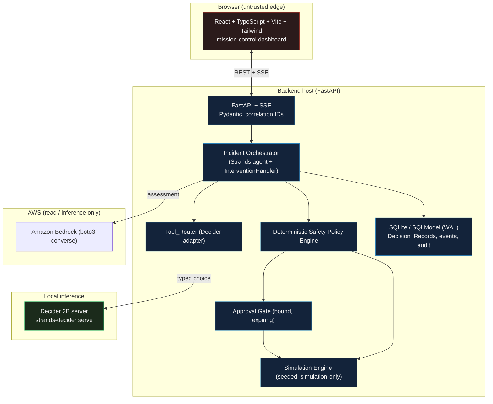

# AegisPulse AI — Detect. Decide. Defend.

An autonomous **cloud incident commander** built on the real **Strands Decider 2B** decision model
and **Amazon Bedrock**, behind a **deterministic safety policy** with **human approval** for
high-impact actions. Built for the October 2026 AWS *Agent Experience Hackathon: Strands Decider*.

**Tags:** `#strands-decider-2b` `#tool-selection`

---

## What it does

Launch a synthetic production incident and watch the agent work:

1. A deterministic simulator generates seeded incident telemetry.
2. A Strands agent gathers evidence into an immutable snapshot.
3. **Amazon Bedrock** writes a one-sentence root-cause assessment (grounded reasoning).
4. **Strands Decider 2B** selects the recovery tool via a typed `choice` question over a fixed set,
   returning per-option probabilities and a calibrated confidence in ~200 ms.
5. A **separate deterministic policy engine** authorizes or blocks the candidate.
6. High-blast-radius actions (rollback, scale-out) **always** require human approval.
7. The approved action executes against the **simulated** environment; a full audit trail is persisted.
8. The **Incident Time Machine** replays the incident with modified evidence and diffs the decisions.

> **Architectural thesis (enforced in code):** the Decider **SELECTS**, the deterministic policy
> **AUTHORIZES**, and Bedrock **EXPLAINS** — nothing overrides the one before it. All remediation is
> simulation-only; no component can mutate a real AWS resource.

## Architecture

GitHub renders this diagram inline (Mermaid):



**Decision lifecycle:** select scenario -> simulate telemetry -> gather evidence -> Bedrock
assessment -> Decider tool selection -> policy evaluation -> human approval (if high-blast-radius)
-> simulated execution -> recovery measured -> persisted. Any Decider failure **fails closed**
(blocks automatic state-changing actions; still allows investigate/escalate).

## Repository layout

```
backend/app/
  contracts/     frozen shared types (enums, schemas, protocols)
  decider/       Decider adapter over the reusable pattern
  simulation/    deterministic incident simulator + 5 scenarios
  policy/        deterministic safety policy engine + audit hash-chain
  approval/      bound, expiring human-approval gate
  bedrock/       Amazon Bedrock reasoner (assessment only)
  orchestrator/  Strands agent wiring
  api/           FastAPI app + incident service
  persistence/   SQLite/SQLModel (WAL) store
  events/        SSE event bus
  replay/        Incident Time Machine
  runtime/       Decider server lifecycle + Bedrock reliability (backoff)
  benchmark/     Decider-vs-Bedrock evaluation harness
  main.py        uvicorn entrypoint (module-level app)
patterns/confidence_aware_tool_router/   reusable #tool-selection package
frontend/        React + TS + Vite + Tailwind dashboard
evaluation/      benchmark reports + 50 eval cases + 30 dev cases
docs/            article, demo script, storyboard, checklists, contracts
```

## Prerequisites

- **Python 3.12** (3.11+ works; 3.12 is tested) and `uv` (or pip + venv).
- **Node.js 20+** and npm (for the frontend).
- **~6 GB free RAM** for the Decider model; Apple Silicon (MPS), CUDA, or CPU all work.
- **AWS account with Amazon Bedrock access** and a model enabled in your region
  (default `amazon.nova-lite-v1:0` in `us-east-1`). Bedrock is optional for a basic local run —
  see the env flags below.

## Quickstart (local)

### 1. Backend environment
```
uv venv .venv --python 3.12
VIRTUAL_ENV=.venv uv pip install -r backend/requirements.txt
```
The first run downloads the Decider weights from Hugging Face (~4 GB) into ~/.cache/huggingface.

### 2. Start the Decider model server (keep it running)
```
.venv/bin/strands-decider serve StrandsAgents/strands-decider-2B-qwen3.5-v1-2610 --device mps --port 8777
```
Use --device cpu or --device cuda if you are not on Apple Silicon. Startup-to-ready is ~10-16 s.

### 3. (Optional) Authenticate AWS for real Bedrock reasoning
```
aws sso login --profile YOUR_PROFILE
export AWS_PROFILE=YOUR_PROFILE AWS_REGION=us-east-1
```

### 4. Start the backend (FastAPI)
```
cd backend
# with Bedrock (needs step 3):
AEGIS_ENABLE_BEDROCK=1 PYTHONPATH=. ../.venv/bin/python -m uvicorn app.main:app --port 8000
# without AWS (Decider still runs; assessment skipped):
AEGIS_ENABLE_BEDROCK=0 PYTHONPATH=. ../.venv/bin/python -m uvicorn app.main:app --port 8000
```

### 5. Start the frontend (Vite)
```
cd frontend
npm install
npm run dev
```
The Vite server proxies /api to the backend on port 8000. Open the dashboard, pick **Bad Deployment**, and watch the agent run.

### Environment variables
| Variable | Default | Purpose |
|----------|---------|---------|
| AEGIS_DECIDER_ENDPOINT | http://127.0.0.1:8777 | Decider serve URL |
| AEGIS_DB_URL | sqlite:///aegispulse.db | persistence DB |
| AEGIS_ENABLE_BEDROCK | 1 | 0 disables Bedrock (no AWS needed) |
| AEGIS_BEDROCK_MODEL | amazon.nova-lite-v1:0 | Bedrock model id |
| AWS_PROFILE / AWS_REGION | - / us-east-1 | standard AWS resolution |

## Tests

```
cd backend && PYTHONPATH=. ../.venv/bin/python -m pytest     # 81 tests: unit, contract, property-based, integration
../.venv/bin/python -m ruff check app                        # lint
cd ../frontend && npm test                                   # component tests
```

## The reusable #tool-selection pattern

`patterns/confidence_aware_tool_router/` is an independently importable package (no AegisPulse
dependency) that wraps the real Decider `POST /v1/systemone` contract: a typed `ToolChoiceDecision`,
a validating `ConfidenceAwareToolRouter`, and `build_intervention_handler(router, policy)` for
Strands. Drop it into your own agent. See its README for usage, limitations, and safety guidance.

## Benchmarks

See [`evaluation/BENCHMARK_REPORT.md`](evaluation/BENCHMARK_REPORT.md). Honest, reproducible,
equal-context comparison (50 cases): Decider 2B matched/beat the Bedrock-only baseline on accuracy
at roughly 3x lower latency, with calibrated confidence. 50 cases is a small sample — no
statistical-superiority claims. The original (pre-audit) results are preserved unchanged.

## Safety

- The only AWS call in the codebase is Bedrock inference (`converse`). No create/delete/update APIs;
  the simulation engine holds no AWS client. No real infrastructure is mutated.
- High-blast-radius actions always require explicit human approval, regardless of model confidence.
- Fail-closed on any Decider failure; the deterministic policy never reads model text
  (structural prompt-injection defense).

## License & attribution

Apache License 2.0 — see [LICENSE](LICENSE). Third-party and model attribution in
[NOTICE.md](NOTICE.md). Strands Decider 2B and the Strands Agents SDK are Apache-2.0.

---

*Decider predictions and confidence are **real model inference**. Infrastructure metrics and
recovery outcomes are **simulated**. Strands Decider 2B is an experimental model; this is an
experimentation project, not a production incident-response system.*
